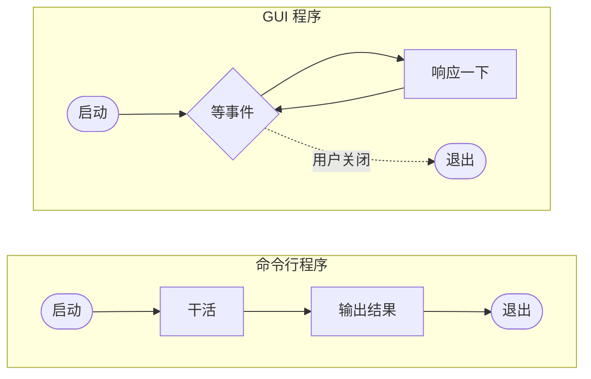
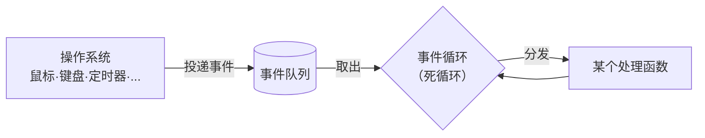
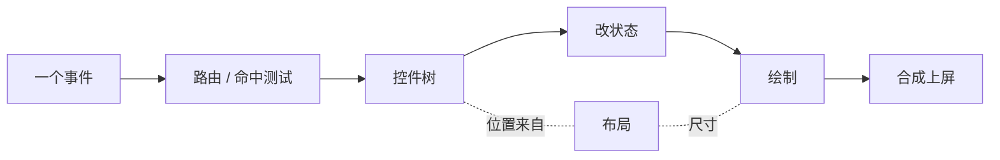
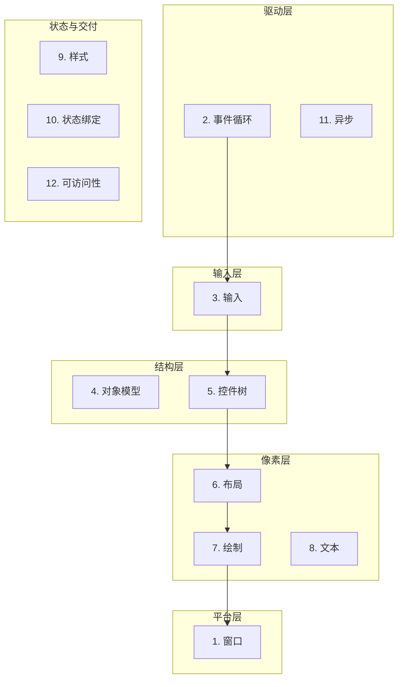
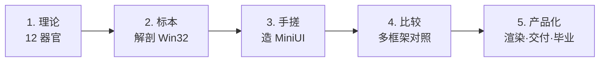

# 为什么 GUI 不是一份 API 清单

以笔者自己为例子，当初学 GUI，是这么个路子：找一份某个框架的教程，跟着敲——创建窗口、摆按钮、响应点击，跑起来了，就觉得自己「会 GUI」了。然后呢，换个框架，两眼一抹黑，又得从零再来一次。

毛病不在您，在姿势。咱们别急着上 API，先退回到最开头，问一个听起来挺傻的问题：

**一个 GUI 程序，和 `ls`、`grep` 这种命令行程序，最根本的区别，到底是什么？**

最普通的命令行程序（这个世界上还有复杂的命令行程序，咱们不敢说死哈）很干脆：启动，干活，把结果吐出来，退出。一条直线，跑完即止，进程随之收摊。

GUI 完全是另一个物种。GUI 启动之后，绝大多数时间它什么都没干——就**蹲在那儿等**。等您挪一下鼠标、敲一下键盘，等操作系统拍拍它肩膀说「嘿，用户戳你了」。它应一声，处理一下，**接着等**。如此往复，直到您把它关掉。

看出门道了吗？**GUI 程序的本质，是「被动」**——它从不主动推进任何事，它的整段生命，就是「等事情发生，然后响应」。就这一条，决定了 GUI 往后所有的设计为什么长那样。

**那这个「等」，到底是谁在等？怎么个等法？**

就是您在每个 GUI 框架里都躲不开的那个老面孔——**事件循环**。说白了，它就是一个死循环，蹲在原地一遍一遍地问操作系统：有事没？有事没？有事没？——有了，捞出来，分发出去。您要是翻过我们 Win32 篇，这俩动作脸熟得很：`GetMessage` 把消息捞出来，`DispatchMessage` 把它派给对应的窗口过程——就这一对，撑起一整个程序。

**事件分发出去，给谁？**

屏幕上乱七八糟摆着那么多东西——按钮、输入框、菜单、滚动条——您这一鼠标点下去，操作系统只知道「坐标 (x, y) 有动静」，可它怎么知道该把这个动静交给谁？得有个东西把界面上这些零碎组织起来。于是**控件树**登场：界面被组织成一棵树，点击落到哪个枝丫上，就由它来管。

可控件得先知道自己「在屏幕上的哪儿、多大一块」，才判断得出点没点中——这就要靠**布局**，先把每个控件的位置和尺寸算明白。Win32 里这事最赤裸：一个 `MoveWindow`（或 `SetWindowPos`），坐标和尺寸全靠您自己塞，框架才懒得替您算。

点中了某个控件，它响应您的操作，多半要改点东西、再把自己重画一下：**状态**变了，**绘制**跟上，最后**合成**这一步，把新画面送上屏幕。

好，停一下，回头瞅瞅刚才走过的这几步：**等事件 → 分发 → 找控件 → 算布局 → 改状态 → 重画 → 上屏**。请问，这里头有哪一步是「Win32 特有」，或者「React 特有」的？

**一步都没有。** 不管您用的是 Win32、GTK、Qt、React 还是 ImGui，任何一个 GUI 程序要做任何一个交互，都得把这一串事走完。框架之间真正的差别，从来不在「做不做这些事」，只在「每件事**怎么做**」——对象身份是系统托管还是每帧重建？事件用消息、回调还是 signal？布局手算还是约束求解？这些都是**同一个问题的不同答案**。

这就是这本书的全部论点，一句话：**所有 GUI 框架，都在回答同一组问题；API，不过是各自的答卷。** 您要是只背答卷、不看出题，换个框架——换张卷子——当然抓瞎。

这组「绕不开的问题」，我们整理成了 **12 个器官**。下一章《GUI 的 12 个器官》，咱们就把这张地图正式摊开，一个一个看清楚：每个器官到底在解什么问题、各家是怎么答的、本书又在哪一章解剖它。先给您瞅一眼全貌：

至于这本书怎么陪您把这具骨架从无到有造起来——路子是死的，五步：先讲理论搭世界观，再拿最透明的标本（Win32）下刀解剖，再亲手搓一具教学骨架（MiniUI），再拉几个工业框架（GTK / WinUI 3 / ImGui）互相照镜子，最后把玩具推向真实软件（渲染栈、DPI、可访问性、打包）。

末了撂一句：**框架会过时，器官不会。** 学透这 12 个器官，往后任何 GUI 框架在您眼里，都藏不住。

咱们，下一章见。
