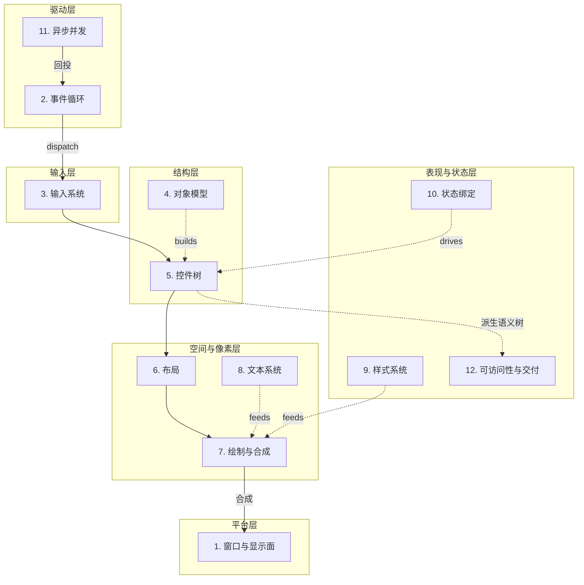

# GUI 的 12 个器官

## 引子：框架是变奏，问题是永恒的

> 如果您之前是看我们 Win32 的一些使用指南，初步理解了 Windows 的GUI抽象的朋友，现在我们要做的事情就是重新对得起我们 anatomy_gui 这个名字——提炼我们学习的具体的API，走到更加一般化，和普遍化的GUI理论。

Win32、GTK、WinUI 3、ImGui、Flutter、Qt、React——这些框架的 API 表面千差万别，学起来仿佛是七门不同的手艺。但只要你在其中任意两个里都认真写过东西，就会产生一种说不清的既视感：**它们在回答同一组问题**。

这组问题不是某个框架的设计者发明的，而是「人与机器交互」这件事本身规定的。只要你想让一块屏幕接受输入、显示反馈，你就绕不开它们。

我们斗胆将把这组问题整理成 **12 个器官**。所谓「器官」，借用的是生物学隐喻：一个 GUI 框架就像一具生物体，12 个器官各司其职、协同维持「交互」这条命。不同框架是不同物种——骨骼相同、形态各异。**这正是书名「剖析 GUI——从零造一具骨架」的由来**：我们要把这具骨架造一遍，再看任何框架都只是一组你已经熟知的变奏。

为什么是 12 个，而不是 5 个或 50 个？这是粒度的取舍：粗到能形成一张完整的世界地图，细到每一个都值得单独深挖一章。你以后看任何框架的文档，都可以试着把它「还原」成这 12 个器官的某种拼法——这一章就是那张地图。

## 12 器官全景图

先把整具骨架一次看清。图中实线是一次交互的主数据流（事件循环 → 输入 → 控件树 → 布局 → 绘制 → 合成回窗口），虚线是供给关系（样式喂给绘制、状态驱动控件树、对象模型构建控件树……）：



接下来，我们挨个器官看一看：每一个，它到底在解决一个什么问题？各家是怎么答的？这本书里又会在哪里展开？

## 12 个器官逐个看

### 1. 窗口与显示面

对于窗口和显示面层，我们尝试问的问题是这样的：

**我们下的像素往哪里画？谁来给应用一块能被看到的「领地」？**

对于一个 **GUI** 程序，窗口是 GUI 的「地」。注意，不是您看到的一个桌面客户端上出现的窗口——它可能是一块操作系统管理的真正窗口（Win32 的 `HWND`、X11 的 window、Wayland 的 surface），也可能只是页面里的一个 `<canvas>` 或一块 div。显示面是窗口里那个「可以被画上去的二维平面」——它有像素、有尺寸、有 DPI、可能有多缓冲。

### 2. 事件循环

GUI 是「被驱动」的——**谁来等事情发生、把它分发出去？**

事件循环是 GUI 的心脏。如果您还记得我们Win32 GUI编程的那个章节，您一定不会忘记这样的代码段。

```c
MSG msg;
while (GetMessage(&msg, NULL, 0, 0)) {  // 阻塞等一件事
    TranslateMessage(&msg);
    DispatchMessage(&msg);               // 分发给对应的窗口过程
}
```

而同一个器官，在声明式世界里长成了纯函数的模样。Elm 把它写成（见 《The Elm Architecture》）：

> 1. Wait for user input.  
> 2. Send a message to `update`.  
> 3. Produce a new `Model`.
> 4. Call `view` to get new HTML.  
> 5. Show it.  
> 6. And Then **Repeat!**

同一个「等待—分发—更新—重画」的循环，一边是 `GetMessage` + `WndProc` 的状态突变，一边是 `msg → update(纯) → view(纯)`。**这就是「12 器官是永恒问题，框架只是不同答案」最直观的一例**。

### 3. 输入系统

一个不能交互的GUI程序，**中看不中用！**键盘鼠标的原始信号，如何变成「点击了这个按钮」这样的语义事件？

原始的按键、移动、滚轮，和「用户激活了保存命令」之间隔着好几层：命中测试（点中了谁）、焦点（键盘给谁）、捕获（拖拽中持续接管）、手势识别。输入系统的难点不在收事件，而在**把物理动作翻译成语义意图**。

### 4. 对象模型

一个「控件」到底是个什么东西？这话听着像废话，可这恰恰是各框架打得最凶的地方。

**它有没有身份？谁拥有它？它归谁管、什么时候死？**

您回头看看我们学过的 Win32：一个 `HWND` 是操作系统托管的东西，您创建它、销毁它，可它的「身份」是系统给的，您只是借用。换个框架，答案立刻变样——GTK 的 `GObject` 靠引用计数续命，Qt 的 `QObject` 靠父子关系撑起一整棵所有权树（父亲还在，孩子不许先走），WinUI 则抬出 `DependencyObject`。最拧巴的还得数 React：它的组件**根本没有持久身份**——每帧重新描述一遍，框架全靠一个 `key` 去猜「这帧的它」跟「上帧的它」是不是同一个。

Fowler 在 《GUI Architectures》 里有一句挺毒舌，但是也很准的话：MVC 压根不是一个模式，它是一捆想法的集合，谁看谁抽走一部分。对象模型这个器官，就是这「一捆想法」的重灾区——同样写「控件」两个字，意思能差出十万八千里。我们到了 MiniUI 篇会亲手给控件安一个身份，到 Act 2 再把 QObject / GObject / DependencyObject 摆一块比。

### 5. 控件树

界面里那么多东西，总不能一锅粥吧？得有个组织法吧！而几乎所有的 GUI 框架，最后都收敛到了同一招——一棵树。

**谁是谁的子节点？这棵树长什么样？**

刹车！我知道您要跟我开始画起来一颗又一颗多叉树了。懂你意思bro，但是不着急，「控件树」其实不是一棵树，是一族树。逻辑树管的是「谁是容器、谁是子项」，视觉树管的是「最后真画出来的层级」，还有一棵语义树专门给屏幕阅读器看（这个我们到第 12 个器官还会再提）。同一个界面，能画出三棵不一样的树来。

React 那篇 《Thinking in React》，第一步就让您把 UI 拆成组件层级——那就是声明式世界的控件树。它还有个挺有意思的观察：UI 长成的树形，常常跟数据模型长成的树形一模一样。

### 6. 布局

控件组织好了，下一个头疼的问题就来了：每个控件到底摆在哪、画多大？换而言之，当我再叹气：“控件布局不对，像素要偏移5个pixel”的时候，框架是如何做的？

这一步，各框架的差距大得离谱。Win32 丢给您一个 `MoveWindow`，坐标自己算去吧，我懒得管。您要是空间感差点（嗯，比如说我），一个布局，一个键盘，一个笔记本电脑，我能调一下午。CSS 弄出盒模型和流式布局，让浏览器替您算。WinUI 拆成 measure、arrange 两遍走。Cocoa 的 Auto Layout 更绝，干脆让您写一堆约束方程，丢给求解器去解。

您瞧，同一个器官，从「全凭手算」到「解线性方程组」，跨度能拉这么大。我们在 MiniUI 篇会带您亲手造一遍布局。

### 7. 绘制与合成

重头戏来了！

前面几个器官，各家虽然吵，好歹还在一个频道里。一到绘制，直接撕成两大阵营。

**谁决定什么时候重画？状态攥在谁手里？**

Casey Muratori 在 2005 年那篇 《Immediate-Mode GUI》 里划了一刀，他说：**保留式（retained）GUI 的那些毛病，跟 retained-mode 图形 API 的毛病一模一样**——状态全攥在框架手里，应用这边想保持一致，难如登天。于是 ImGui 反着来：每帧由您的代码把整个 UI 重新描述一遍，框架什么都不留。

这就是 GUI 圈那桩最著名的公案——「保留 vs 即时」。**说白了，它争的根本不是新旧，是状态到底该归谁管。**

画完了也还没完，后头还有一道合成：DWM、GPU compositor 把一层层图拼上屏，脏区重绘、半透明、毛玻璃，全在这一层。我们的 Act 3，整个渲染栈（GDI → Direct2D → Direct3D）就是围着它转的。

### 8. 文本系统

您要是觉得「画一行字能有多难，不就一个 drawString 吗」——那这一节就是写给您的。

**为什么画一行字，比画一个矩形难那么多倍？**

一个字符要落到屏幕上变成字形，中间得过字体匹配、shaping（英文连字、阿拉伯文合字这类）、BiDi 双向排版、断行、缺字 fallback——一道接一道。这还没算上中文读者最头疼的输入法：您敲下去的键，先进 IME 变成一串候选（composition），等您选定了，才真正 commit 成文字。

所以记住，文本不是字符串，输入也不等于按键。这是 GUI 最容易被低估的深水区，我们到 Act 6 会专门趟一遍。

### 9. 样式系统

代码写着写着您就会发现，颜色、字号、间距这些东西，撒得满代码库都是——想换个主题，得翻遍整个项目。样式系统就是来收拾这摊子的。

**外观怎么从代码里摘出来，统一管，还能一键换皮？**

CSS 是最出名的那个，它索性把样式做成了一门单独的语言。Qt 有 style sheet （QSS那套）和 QStyle，WinUI 抬出 `ResourceDictionary`，GTK 也搞了一套 CSS 风格的主题。殊途同归：换个皮，不必动逻辑代码。

### 10. 状态绑定

界面不是死的，数据一变，界面得跟着变。而「这跟着变」由谁来操心，正好是命令式和声明式的分水岭。

**数据变了，界面由谁、怎么跟着更新？**

打住——笔者自己头一回撞见「状态绑定」这个词，脑子里蹦出来的也是 MVVM。先别急着往上靠：MVC / MVP / MVVM / TEA 是**架构模式**（回答「整个应用切成几块、谁管谁」，第 4 器官引的 Fowler 那篇讲的就是它）；而「状态绑定」只是一个**器官**（只回答「数据变了，界面这一条线怎么跟着连」）。一个像组织架构图，一个像电路连线，正交的两码事。

您看，写个 Win32 啥 MV* 都没用，照样得做状态绑定（手动 `SetWindowText`）；反过来，用 MVVM 的人，binding 也分手动和自动。**架构模式是选答题，状态绑定是必答题。** 至于 MVVM 为什么偏偏跟它绑得最紧——因为 MVVM 把这个器官直接提拔成了招牌：ViewModel 这个角色存在的全部意义，就是被 View 绑定。

命令式的世界（比如我们的 Win32），全靠您自己——数据一变，您老老实实 `SetWindowText` 把新值塞回去。声明式的世界把这事整个翻过来：您只描述「状态长这样的时候，界面该长什么样」，状态一动，界面自动重算。

React 那篇 《Thinking in React》 给了两条挺硬的纪律：**单向数据流，外加 state 最小化**——凡是能从已有的 state 算出来的，就千万别再存一份。Elm 更绝，`Model → view → Msg → update → Model` 一个闭环，全程没有一个隐式突变。我们会在 MiniUI 篇亲手把信号和响应式造出来。

### 11. 异步并发

GUI 有条铁律：主线程不能卡。您要是在主线程里读个大文件，界面当场僵住，用户点什么都像石沉大海。耗时的活交给谁干？干完了，又怎么把结果送回 UI？

> 这个很是经典，笔者之前接手处理过的一个问题就是吐槽：点击你们的软件直接卡死了！后来一看我开麦吐槽了——谁家好人把重活丢到同步线程中了？？？

几乎所有的 GUI 框架都认死一条理——只有主线程能碰控件，这叫「UI 线程亲和」。所以脏活累活得扔到后台线程去，干完了再把结果「投递」回主线程：Win32 用 `PostMessage`，Cocoa 用 `dispatch_async(main)`，时髦一点的就上协程配 Dispatcher。

这个器官，处理的其实是「时间」——界面要永远跟手，活儿却得在别处慢慢磨。我们 MiniUI 篇的协程和线程池，就是围着它造的。

### 12. 可访问性与交付

前面 11 个器官您都摸透了，凑出来的程序，看着已经挺像样。但「能 demo」跟「能交付」中间，还隔着一条挺宽的护城河。

**屏幕上有像素，就等于「谁都能用」了吗？一个 demo，离真正的软件还差多远？**

先说可访问性（a11y）。您画的那个按钮，在您眼里是按钮；可到了屏幕阅读器眼里，它可能就只是一个矩形——因为读屏软件要的是一棵「语义树」，每个节点都得交代清楚：自己的角色（role）、名字（name）、值（value）、状态（state）。自绘控件最容易栽在这儿，您画得起劲，残障用户却根本摸不到。

再说交付。DPI 适配、国际化、主题切换、高对比度、打包安装、自动更新、崩溃上报、自动化测试……每一样，都能让您那个「明明跑得好好的 demo」在用户的机器上当场翻车。这些活儿，我们到 Act 6 一个一个收拾。

## 一次点击的旅程：把 12 器官串起来

光看清单，您可能还感觉不到这 12 个器官怎么配合。那我们换个法子：跟着「用户点了一个按钮、按钮里的数字 +1、重画上屏」这件小事，把这具骨架走一遍：

1. 一开始，按钮能被您看到，靠的是上一轮的**绘制 + 合成上屏**——没这步，根本没东西可点。
2. 您按下鼠标，**输入系统**接到原始事件，塞进队列。
3. **事件循环**把它捞出来，分发出去。
4. 到底点中了谁？这一步叫命中测试，要查**控件树**的层级和**布局**算出来的矩形。
5. 被点中的那个按钮——**对象模型**里一个有身份的控件——收到点击，触发回调。
6. 回调去更新**状态**：计数 +1。命令式的话您直接改，声明式的话就发一个 `Increment` 消息。
7. 状态一变，就得标记一块要重画的「脏区」。
8. 要是尺寸也跟着变了，**布局**还得重算一遍。
9. **绘制**重画脏区，**文本**把新的数字重新排版，**样式**供给颜色和字号。
10. **合成**把结果送上**窗口**，上屏。
11. 这会儿要是用户开着屏幕阅读器，**可访问性**还得同步通知语义树：「这个按钮的值变了」。
12. 全程一秒都不能卡——**异步并发**守在旁边，保证任何耗时的活儿都不挡在这条主线前面。

12 个器官，一次点击，一个没落下。**这里头没有什么「高级功能」是可以省的**——您省掉任何一个，这次点击就会在某一步戛然而止。

## 小结

12 个器官，就是 12 个绕不开的问题，也就是一张地图。

往后您碰上任何新框架，别急着背 API——先把它往这 12 个器官上一套，陌生感会褪掉大半。看一个老框架里某个奇怪的设计，问一句「它这是在解哪个器官的哪个问题」，常常比翻文档还管用。等您哪天想自己造一个框架，就会发现：造框架，说到底就是挨个器官做选择——保留还是即时？命令式还是声明式？绝对坐标还是约束布局？

这本书接下来的每一章，无非就是带您钻进其中一个器官，先拿 Win32 这具最透明的标本看它的原始形态，再在 MiniUI 里亲手把它的骨架搭一遍，最后到 Act 2 拿多个框架比一比它的不同拼法。

12 个问题问完，任何 GUI 框架在您眼里，都藏不住。

---

> **延伸阅读**（本章论点的原始出处）
>
> - Casey Muratori, *Immediate-Mode Graphical User Interfaces* (2005) — 保留 vs 即时模式之争的源头。
> - Martin Fowler, 《GUI Architectures》 — MVC / MVP / Presentation Model / MVVM 的演进梳理。
> - Evan Czaplicki, 《The Elm Architecture》 — Model-View-Update 循环。
> - React 团队, 《Thinking in React》 — 单向数据流与 state 最小化。
