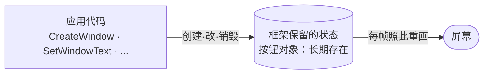
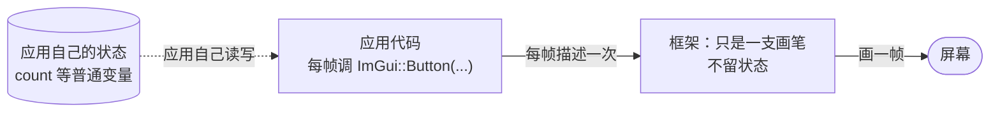
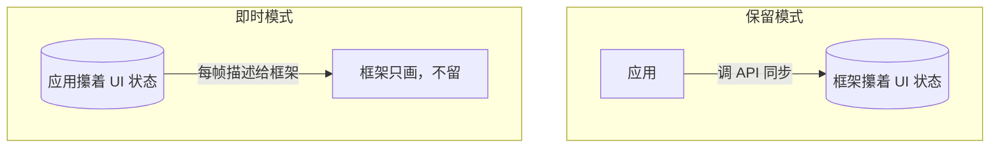

# 保留模式 vs 即时模式：状态归谁管

我们翻开IMGUI的示例教程。。。嗯？看着很奇怪哦。

```cpp
void draw() {
    if (ImGui::Button("Click")) { count++; }
    ImGui::Text("count = %d", count);
}
```

每一帧，都把整个 UI 重新描述一遍。我当时脑子里全是问号：那个 `Button`，到底「存在」于哪儿？我每帧调一次 `ImGui::Button`，它怎么记得住自己被点过？那个 `Text` 的内容变了，是谁触发它重画的？——在 Win32 里，这些事儿背后都有一个「长期存在的对象」撑着，可 ImGui 这里，好像什么都没留下。

归根结底，其实这些疑问都是一个疑问：**界面的状态，到底归谁管？**

## 先看我们最熟的：保留模式

绝大多数 GUI 框架，走的是「保留模式」（retained）。Win32、Qt、GTK、HTML DOM，全是。

它的规矩是：您创建一个控件，它就**长期存在**于框架那边——框架替您记着它的身份、位置、状态、父子关系。拿 Win32 建个按钮：

```c
HWND btn = CreateWindowW(L"BUTTON", L"Click",
                          WS_CHILD | BS_PUSHBUTTON,
                          x, y, w, h, hwndParent, (HMENU)id, hInstance, NULL);
```

这一行跑完，按钮就「活」在系统里了。它有自己的 `HWND`（身份）、自己的位置尺寸、自己的窗口过程。您不去碰它，它就在那儿待着；想改它，得**主动调 API**——`SetWindowText` 改文字、`MoveWindow` 改位置；想让它响应点击，框架会把 `WM_COMMAND` 消息派到您父窗口的窗口过程里。

为什么叫「保留」？因为**框架把上一次的 UI 状态保留了下来**——它记得有几个按钮、各自在哪、文字是什么。下一帧要画的时候，框架翻出自己留的这套底账，照着画就行，不用您的代码再交代一遍。



## 再看那个让人发懵的：即时模式

ImGui 走的是另一条路：即时模式（immediate）。

它的规矩反过来——您**每一帧**都把 UI 完整描述一遍，框架什么都不替您留：

```cpp
void draw() {
    if (ImGui::Button("Click")) { count++; }
    ImGui::Text("count = %d", count);
}
```

`ImGui::Button("Click")` 这个调用，干两件事：这一帧，把按钮画出来；如果这一帧鼠标点中了它，返回 `true`。**下一帧**，您再调一次，它再画一次。框架**什么都不保留**——它不记得「有这么个按钮」，按钮「存在」于您每帧的那次调用里，您这帧不调，它就没了。

那 `count` 住哪儿？住**您自己的代码**里，一个普普通通的变量。ImGui 不帮您记任何 UI 状态，状态全在应用侧。



## 把两张脸摆一起：争的是「状态归谁管」

两种模式摆一块，差别其实就一句话：

- **保留模式**：UI 状态归**框架**管。框架保留着控件树和属性，您的代码只在「需要改」时出手调 API。
- **即时模式**：UI 状态归**您的应用**管。框架只是一支「每帧把您的描述画出来」的画笔，上一次长什么样，框架压根不关心，您自己记。

Casey Muratori 在 2005 年提出这概念时讲得很直白：**保留式 GUI 的那些毛病，跟 retained-mode 图形 API 的毛病一模一样**——状态全攥在框架手里，应用这边想跟框架保持一致，就得反反复复地同步，又累又容易对不上账。他把状态一把拿回应用侧，发现一切都清爽了。



## 别分新旧，分舞台

写到这儿得赶紧踩一脚刹车——很容易让人误会「即时模式是新的、先进的，保留模式是老的、该淘汰的」。**这是个大坑，别往里跳。**

两者到今天都是活生生的，各有各的舞台：

- **保留模式**适合**复杂的应用界面**：一个塞满几十个对话框、菜单、嵌套窗口的 IDE 或办公软件。控件长期存在、有身份、能被外部查询和操控（辅助技术读它、自动化测试点它），保留模式更顺手——您总不能让屏幕阅读器去读一个「只在某帧调用时才存在」的按钮。
- **即时模式**适合**工具 / 调试 / 游戏 UI**：一帧一帧变的调试面板、游戏里的血条 HUD、内容高度动态的编辑器。这些 UI 的状态本来就活在应用的核心逻辑里，每帧顺手画一遍最省事，何必再额外维护一套「控件对象」跟核心状态对账？

ImGui 官方自己都反复强调：**它不是来取代 Qt 的，它是给游戏和工具用的。** 这话很实在——选哪种模式，看您手里的活儿适合让谁记状态。

## 同一具骨架，两种拼法

最后把话头接回 T01：保留 vs 即时，**不是两类不同的 GUI 框架，而是同一个器官（绘制与合成）的两种解法**。它回答的就是第 7 个器官那个问题——「谁决定什么时候重画？状态攥在谁手里？」

- 保留模式答：**我攥着**，应用要改、跟我打招呼。
- 即时模式答：**你攥着**，每帧告诉我现在长什么样，我照画。

本书的 MiniUI 选的是保留模式（控件树长期存在），因为这是学「框架内部设计」最经典、最经得起推敲的形态。可等您走到 Act 2，把 ImGui 这具标本摆上解剖台，就会看到：同一具骨架，换成即时模式这副拼法，整个画风都变了，而底下要解的问题，一个都没换。

---

往后您再碰到一个新框架，别急着翻它的 API 文档。先问它一句：**你把 UI 状态攥在框架那边，还是留在应用这边？** 这一问下去，这个框架的一大半性格，就全露出来了。
