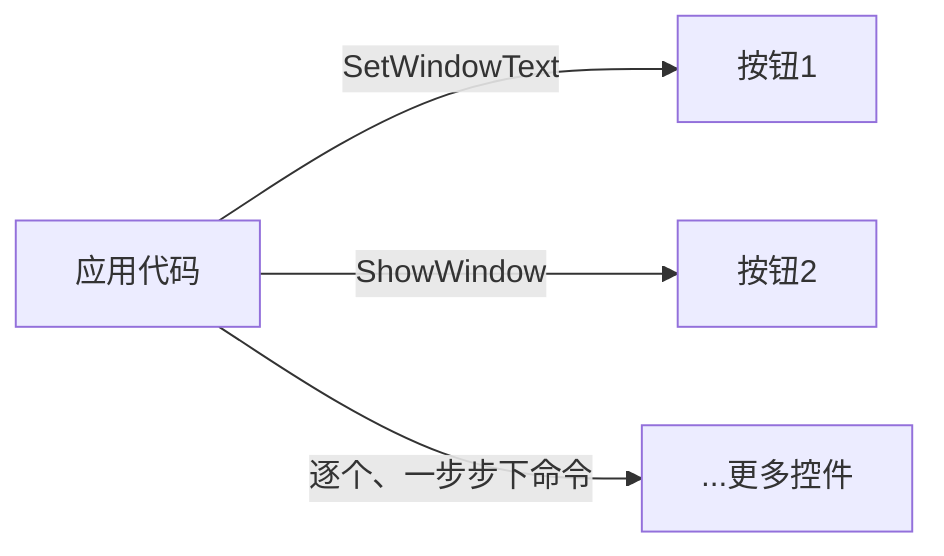
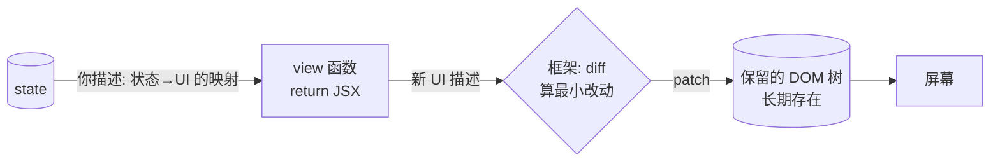
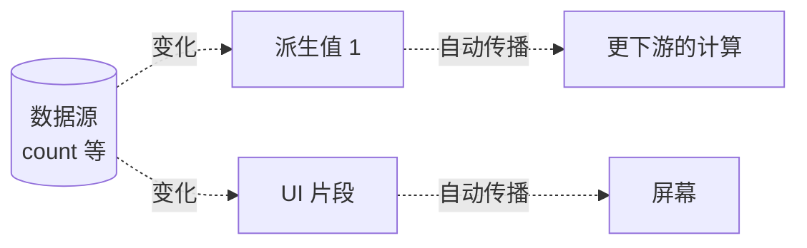

# 命令式、声明式、响应式：你把多少活儿交给框架

您习惯了 Win32 那套写法——想让界面上的数字变一下，第一反应是找个 `SetWindowText` 之类的函数、对着那个控件改它。然后某天您翻开 React 的教程，发现那里压根不「改」界面——您只动一个叫 state 的东西，界面自己就跟着变了。

这俩写法，差得到底在哪？

差在「谁来干活」。这就是 GUI 编程里三种范式的核心分歧：**命令式、声明式、响应式**。它们不是三个流派互相对骂，更像三层台阶——每上一级，你都把更多的活儿甩给框架，自己少操一份心。

## 命令式：你说了算，每一步都你管

这是咱们最熟的。Win32 就是命令式的典型。

想让按钮上的字从「0」变「1」？你直接对它下**命令**：

```c
SetWindowTextW(hButton, L"1");
```

清清楚楚：哪个控件、改成什么、就这一步。想让它隐藏，再 `ShowWindow(hButton, SW_HIDE)`；想禁用它，再 `EnableWindow(hButton, FALSE)`。每一步都是你亲手指挥，框架是个听话的执行者——你不说，它不动。



好处是**你说了算**，精确到每一步，没有意外。坏处也实在：界面一复杂，你得自己记着「现在屏上每个东西都长什么样」，稍不留神就漏改一处，状态和界面对不上账。ImGui 那种「每帧重画」的写法，骨子里也是命令式——每帧你亲手把要画的东西列一遍，只不过列的频率是每帧一次。

## 声明式：你说目标，框架算怎么走

声明式换了个思路：你不再一步步指挥了，而是描述「状态长这样的时候，界面就该长这样」，至于怎么从旧样子改到新样子，框架自己算。

React 是典型。你写一个函数，说清楚「count 是这个值时，界面长这样」：

```jsx
function Counter({ count }) {
  return <div>{count}</div>;
}
```

想让数字变？你不碰界面，你只改 state：

```jsx
setCount(count + 1);   // 只改状态，界面自己跟上
```

框架拿到新 state，重新跑一遍你的描述，得到「新界面该长什么样」，再跟「上一次的界面」对比，算出最小改动，应用到真实的 DOM 上。这个「对比 + 应用」的活儿，有个学名，叫 reconciliation（协调）。



## 响应式：状态一变，依赖自动跑

响应式再往前走一级：连「该谁来触发更新」这件事，都给你自动化了。

你声明一些数据源、和一些依赖它们的结果；数据源一变，所有依赖它的结果自动重算、自动传播。Excel 就是这个星球上最普及的响应式系统——你改一个单元格，所有引用它的格子全跟着变，根本不用你一个个去通知。

GUI 里，signals、observable、Elm 的 `update` 循环，都是响应式这一家的。Elm 那套咱们在 T01 见过：状态 `Model`、消息 `Msg`、纯函数 `update` 把旧 Model 变新 Model、`view` 再把新 Model 变成界面——一个数据闭环，全程没有一处「你得记得去通知谁」的活儿。



## 关键洞察：声明式不是魔法，它底下还得有一棵保留树

写到这儿，很容易冒出一个错觉：声明式、响应式这么省心，是不是要把命令式淘汰了？

慢着——声明式 UI 之所以能「你只描述、它自己改」，是因为**底下有一棵长期存在的控件树在撑着**。React 的声明式 JSX，最终是跑在浏览器那棵保留的 DOM 上的；框架每帧 diff 出改动，再 patch 到那棵 DOM 上。换句话说：

> **声明式范式，是建在保留模式（见 T02）的地基上的。**

而那个 diff + patch 的过程，本质上仍是一连串「命令式」的 DOM 操作——只不过这些命令不再由你亲手写，而是框架替你算、替你发。**命令式从来没有消失，它只是被框架吃进了肚子里。**

这就把 T02 那道分叉的另一面也接上了：保留 vs 即时，争的是「状态归谁管」；命令 vs 声明 vs 响应，争的是「你和框架怎么分工」。两道分叉正交——你可以是「保留模式 ＋ 命令式」（Win32），也可以是「保留模式 ＋ 声明式」（React，底下保留着 DOM），理论上甚至可以有「即时模式 ＋ 声明式」的怪胎（某些实验性框架真试过）。

## 三级台阶，看你愿意交出多少控制权

把三种范式摆一块儿，本质就一句话：**你愿意把多少活儿交给框架，自己留多少控制权？**

- **命令式**：控制权全在你手里，精确、直接，但「状态和界面要时刻保持一致」这份脏活得你自己干。
- **声明式**：你交出「怎么改」的控制权，换来「状态和界面永远一致」的省心；代价是要信任框架的 diff 算法，且底下那棵保留树仍在。
- **响应式**：你连「何时触发更新」都交给依赖追踪，最省心，但调试起来数据流可能绕得你想骂人。

没有谁淘汰谁这一说。写一个像素级精雕的自绘控件，你多半还得退回命令式；写一个数据驱动的长表单，声明式舒服得多；做一屏互相联动的实时图表，响应式最顺手。**挑哪一级台阶站，看你手里那摊活儿。**

本书的 MiniUI，会带你把这三级都亲手摸一遍——从命令式的 `SetWindowText` 风格起步，一步步加上信号和响应式。等你自己造过一遍，再回头看 React、Elm、Vue 这些框架，就能一眼看出它们各自站在第几级台阶上，又各自交出了哪份控制权。
