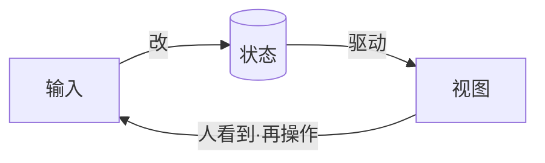
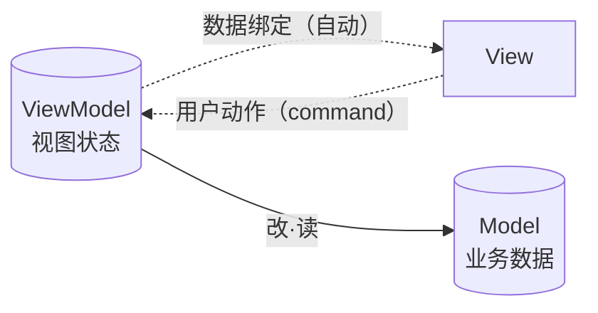
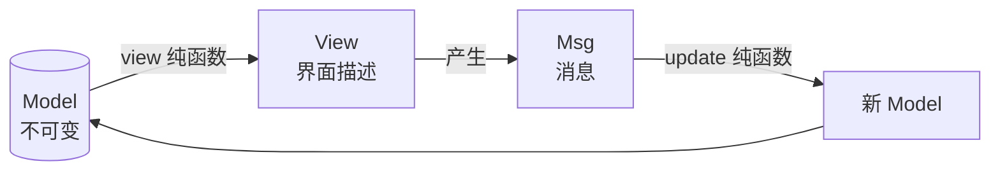
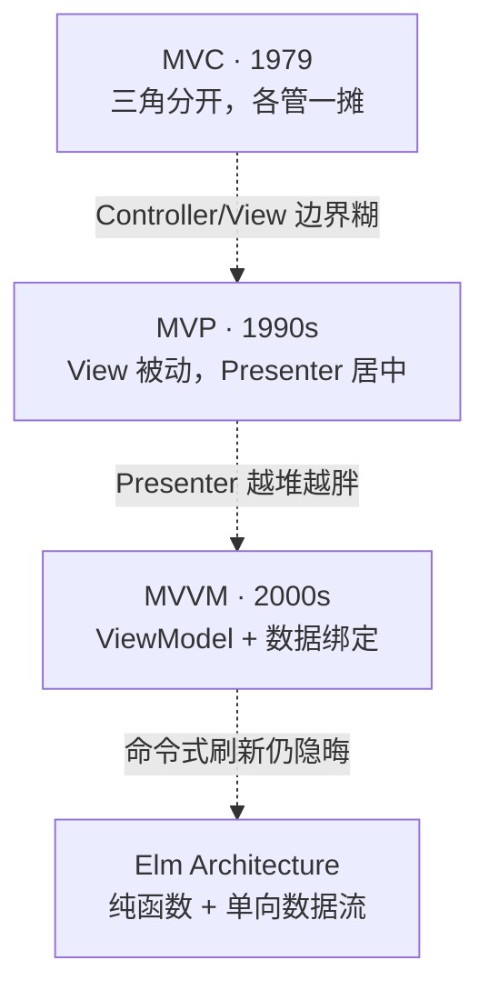

# MVC / MVP / MVVM / Elm Architecture：同一道题的四代解法

MVC、MVP、MVVM——这几个词儿，长得像、意思近，头一回撞见很容易绕进去：它们到底有啥不一样？为啥前人要发明这么多差不多的缩写？是不是就为了把后辈绕晕？

后来读了一圈才回过味来：**它们不是平行发明的几套东西，而是同一道题、四代人交的不同答卷**，每一代都在修上一代踩的坑。

那这道「题」，到底是什么？

## 这族模式要解的题：状态—视图—输入的三角循环

任何一个交互式应用，不管它挂什么模式的牌子，都得对付仨东西：

- **状态**：应用真正关心的东西——计数器的值、文档的内容、当前登录的用户。
- **视图**：把状态画出来给人看的那一层。
- **输入**：用户的操作——点击、键盘、手势，是人想改变状态的途径。

这三者之间，天然有个循环：**输入改状态 → 状态变 → 视图跟着变 → 人看到新界面 → 再输入……**

这个圈绕得顺，应用就丝滑；绕不好，就是各种状态对不上账、界面乱闪、逻辑缠成一团。MVC、MVP、MVVM、Elm Architecture，全是奔着「把这个循环组织清楚」去的。下头一代一代看，看它们各自怎么画这个圈，又各自修了前人什么毛病。

## 第一代 · MVC（1979）：三角分开，各管一摊

最老的 MVC，1979 年在 Xerox PARC 的 Smalltalk 里由 Trygve Reenskaug 提出（咱们在 T01 引过他那份原始笔记）。想法很清爽，三角分三个角色：**Model** 是状态，它不关心谁在看它；**View** 订阅 Model、把它画出来；**Controller** 接用户的输入、决定怎么动 Model。

漂亮是漂亮，可真用起来坑就来了：**Controller 和 View 的边界会糊**。Controller 到底管不管界面逻辑？View 要不要知道输入？后来 Web 时代的人又把 MVC 重新解释了一通（Model 当数据库、View 当模板、Controller 当路由），跟原始含义早不是一回事了。Fowler 在 *GUI Architectures* 里就吐槽过——MVC 压根不是一个模式，它是一捆想法的集合，谁看谁抽走一部分。这话说得毒，但准。

## 第二代 · MVP：让 View 闭嘴，Presenter 居中

为治「Controller/View 边界糊」这个病，1990 年代有了 MVP（Model-View-Presenter）。关键一刀：**把 View 变成一个完全被动的笨蛋**，所有协调全搬到 Presenter 那儿。

View 只管「展示」和「把用户动作转给 Presenter」，它不直接碰 Model、不做任何决策。Presenter 是大脑——从 View 拿到动作、动 Model、再让 View 刷新。这么一来，View 可以做成哑巴的、可替换的，Presenter 不依赖具体 View，单元测试也好写了。代价呢，Presenter 自己越长越胖，所有界面逻辑全堆它身上，到头来又成一坨。

## 第三代 · MVVM：ViewModel 是为 View 量身定做的 Model

到了 2000 年代，WPF 团队搞出 MVVM（Model-View-ViewModel）。最关键的一笔，是 **ViewModel**——一个专门为某个 View 准备的「视图状态」。

View 不再像 MVP 那样被 Presenter「命令刷新」，而是通过**数据绑定**订阅 ViewModel：ViewModel 的属性一变，View 自动跟着变。「我命令你刷新」那种话，全省了。

瞧出来没？**MVVM 把「状态绑定」这个器官（T01 第 10 个器官），直接提拔成了整个模式的招牌**——ViewModel 这个角色存在的全部意义，就是被 View 绑定。这就是为什么一提状态绑定，大家头一个想到的就是 MVVM（这层关系咱们在 T01 第 10 已经点破过）。Fowler 自己更早提过一个叫 Presentation Model 的模式，MVVM 基本就是它嫁接到 WPF 数据绑定上的产物。

## 第四代 · Elm Architecture：把循环写成纯函数

到 Elm 这儿，整个思路被函数式风格重洗了一遍。三角还是那个三角，但全变成了**纯函数 + 不可变数据**：`Model` 是不可变状态；`view : Model -> Html` 是纯函数，把状态变成界面描述；`update : Msg -> Model -> Model` 也是纯函数，一条消息把旧状态变成新状态。

为什么 Elm、Redux 这种「单向数据流」特别适合把状态循环讲清楚？因为它把每一步都掰开了：**状态只能被 `update` 改、界面只能由 `view` 算、动作只能打包成 `Msg`**——没有一条暗道，数据流向一目了然，调试的时候跟得清清楚楚。

## 四代一张图：每代修了上一代什么

每一代都不是推翻上一代，而是**专治上一代最扎手的那个痛点**。所以别把它们当对立的派别——它们是同一道题的四代答卷。今天您选哪一代，看手里的语言、框架，和最让您头疼的是哪类毛病。

所以收尾看看——

1. **这族模式解的，全是「状态—视图—输入」这个循环怎么组织**——它是 T01 第 10 个器官（状态绑定）的「架构层」表亲，跟状态绑定的「机制层」正交（T01 第 10 已划过这条界）。
2. **它们是演进关系，不是对立关系**——MVC 起头，MVP 治它的 Controller/View 糊，MVVM 治 Presenter 胖（顺手把状态绑定提成招牌），TEA 用纯函数治「数据流难追踪」。

本书的 MiniUI 不会把您绑死在任何一代上。但等您亲手造完自己的状态系统（见 T03 那三级台阶），再回头看这四代，就会明白它们各自在替您省哪份心、又各自把哪份累赘藏进了框架肚子里。
