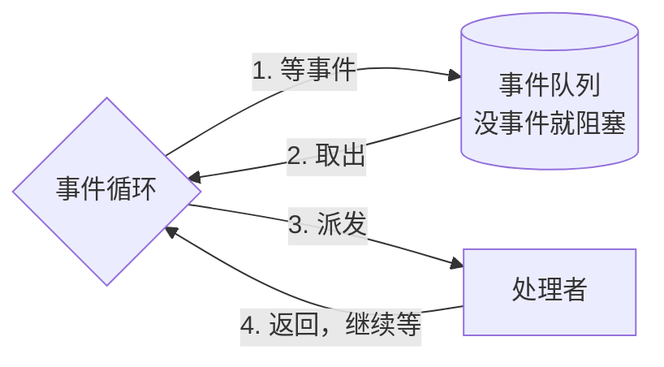
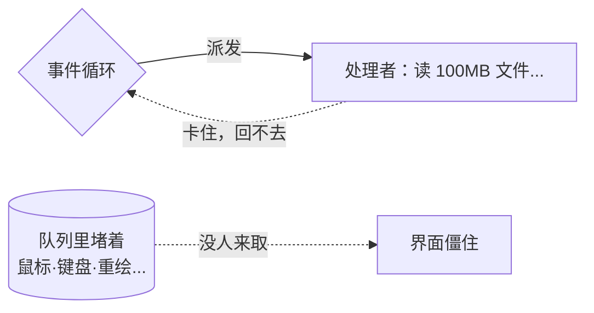
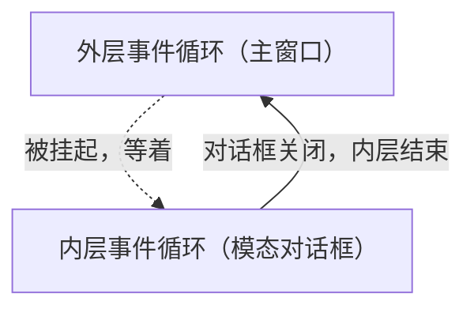
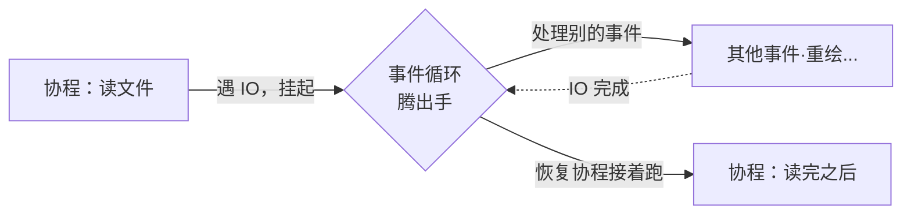

# 事件循环：GUI 的那颗心脏

有过这种经历吗——您写的 GUI 程序，主线程一不小心去读了个大文件、或者等了一趟网络，界面当场僵住，用户点什么都不理，最后只能强杀进程。用户骂「你这软件卡死了」，您还委屈：明明代码在跑啊。

同志们，这就是我们将要讲的**事件循环**。T01 咱们瞥过它一眼（Win32 的 `GetMessage` 循环、Elm 的 `update` 循环），这一章把它拆开，看清楚它到底在循环什么——以及 GUI 里那些让人摸不着头脑的「奇怪行为」，为什么根子全在它身上。

## 事件循环到底在循环什么

先把骨架拎出来。一个事件循环，不管披着哪家的皮，干的都是同一件事：

```
循环 {
    从队列里等一个事件（没事件就阻塞着等）
    把事件派发给对应的处理者
}
```

就这两步，无限循环。Win32 里是 `GetMessage`（等）加 `DispatchMessage`（派）；glib 是 `g_main_loop_run`；Cocoa 是 `[NSApp run]`；浏览器里跑 JavaScript 的那个运行时，也是。



关键在那句「**没事件就阻塞等着**」——这恰恰是它能「等用户操作」的原理。程序绝大部分时间，是阻塞在这一步睡大觉的；一旦操作系统有事件来（鼠标动了、键盘按了、定时器到了），把它唤醒，处理一下，接着睡。

## 那为什么主线程一干重活，界面就卡？

因为「处理事件」这一步，是**在主线程里同步执行的**。要是某个事件的处理者（比如点击的回调）去读了一个 100MB 的文件，这个文件读不完，事件循环就停在「派发」这一步回不去——它再也腾不出手去取下一个事件了。

下一个事件是什么？多半就是用户在这期间又点的鼠标、又按的键盘。它们全堵在队列里没人取。从用户的角度看：界面僵住，点啥都没反应——可不就是卡死了。



所以 GUI 有条铁律：**事件循环的那条主线，绝不能被任何耗时的活儿占住。** 这就是为什么所有 GUI 框架都强制「UI 线程亲和」＋「耗时活儿丢后台线程」（T01 第 11 个器官讲过这条）。这条铁律的源头，就是事件循环的工作机制本身。

## 模态对话框：一种「合法的卡」

可话说回来，有一种「卡」，是 GUI 故意要的——**模态对话框**。

您点「文件 → 打开」，弹出一个选文件的窗口，这时背后的主窗口点不动了，只能先对付这个对话框。这不是 bug，是设计。

机制上怎么做到的？**嵌套消息循环**。弹模态对话框时，原来的事件循环不退，但框架在它里头**再开一个新的事件循环**，专门伺候这个对话框。新循环不结束（对话框没关），旧循环就得不到执行机会——背后的窗口自然收不到事件，点不动。



这是事件循环一个挺反直觉的特性：**它可以嵌套**。模态对话框、某些拖拽过程、COM 的模态等待，都靠它。理解了这一点，您就明白为什么模态对话框里写的代码，「看上去同步，底下却偷偷跑着另一个消息循环」。

## 重入：事件循环的暗坑

嵌套循环还引出一个更阴的坑：**重入（reentrance）**。

您在处理一个事件的途中（比如某个按钮的回调里），调了一个会「顺带跑消息循环」的函数——某个弹框、某个 `DoModal`、某些阻塞式 API。结果事件循环又转起来了，它会去处理**别的**事件，包括您根本没料到的那些。您的回调还没返回呢，另一个事件的处理已经插进来了。

这就是重入：函数还没退出去，就被事件循环「打断」，跑了别的代码。如果那段插进来的代码也会动到回调里正在用的状态——得，bug 就跟着来了。所以处理事件的代码里有个原则：**能不调「会跑消息循环的 API」就不调；非调不可，得把状态护好。**

## 协程：让「等」不再卡住主线程

说到这儿，您大概嗅到一个核心矛盾了：**事件循环必须不停地转，可有些活儿天生需要「等」**（等文件、等网络、等定时器）。让主线等，界面卡；丢线程池，回主线程又啰嗦。

协程就是来调和这个矛盾的。它的魔法在于：您写的代码看上去是「等」的（像同步代码一样顺序往下写，笔者特别喜欢知乎一些大佬的一句话——“用同步的方式写异步，就是如此~”），但编译器把它改写成「遇到等就挂起，把控制权还给事件循环」。等的事完成了，事件循环再把这段协程接下去跑。



这么一来，事件循环始终在转（界面不卡），而您的协程代码写起来还像同步代码一样直观。C++20 协程、JS 的 async/await、C# 的 async，都是这条路子。本书 MiniUI 篇会给您亲手造一个「协程版消息循环」，把这个机制跑个通透。

## 一颗心脏，跳在每一个 GUI 里

回头一瞧，GUI 里那些让人抓狂的现象——卡死、模态、重入、协程救场——根子全在事件循环这一个机制上。

往后您碰到一个新框架，别急着学它的控件 API。先找它的事件循环在哪儿：它怎么等事件？哪些代码跑在循环线程上？它有没有「会顺带跑循环」的 API（重入坑就在这）？支不支持协程？这几个问题答下来，这个框架运行时的脾气，您就摸清一大半了。
