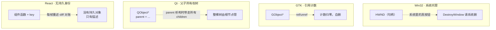

# 控件不是矩形，而是对象

您在屏幕上看到一个按钮，它就是个矩形嘛——一块灰底、几个字、点一下还能按下去。可在 GUI 框架眼里，它远远不止是个矩形。它是一个**对象**，有身份、有生命、有亲戚关系。搞不清这点，您迟早要在「我问你我控件呢？我控件怎么没了？？？」「ber，什么叫他自己莫名其妙析构了？什么叫还要我自己管他？」「？它到底还是不是上次那个控件？这是我new的还是我之前的？」这类问题上栽跟头。

T01 第 4 个器官咱们瞥过各家的对象模型（HWND、GObject、QObject、DependencyObject、React 的 key）。这一章把它拆开看：**为什么一个控件非得是个「对象」？这个对象又该怎么活、怎么死？**

## 为什么控件不能只是一个矩形

假设控件真只是一个矩形——一组坐标、一个颜色、一个点击回调。听着够用了？

真上手做您就发现缺了一堆东西：这个矩形「是」哪个矩形？点击事件来了，您得知道点的是谁——它得有**身份**。它有父容器、有子控件——它得有**关系**。它出现了、消失了、被人改了——它得有**生命期**。别处想引用它、改它——它得是个能被**持有和传递**的东西。

身份、关系、生命期、可引用——这不就是一个**对象**该干的活吗。所以所有 GUI 框架，最后都把控件做成了某种「对象」。区别只在：这个对象由谁托管、怎么标识、谁管它的生死。

## 一个按钮，四种活法

各框架给控件「对象身份」的方式，大致四种。把同一个按钮摆进去对比，最直观：

- **系统托管（Win32 的 HWND）**：您调 `CreateWindow` 拿到一个 HWND——它是个 ID、是个句柄，不是指针。控件真正的对象活在操作系统那边，您只是拿着这个 ID 去跟系统打交道。要删它，请调 `DestroyWindow`，请系统把它收掉。
- **引用计数（GTK 的 GObject）**：控件是个堆上的对象，谁用谁 `g_object_ref` 加一，不用了 `g_object_unref` 减一，归零自己删。灵活，但得当心循环引用——父子互引，谁都不归零，内存就漏了。
- **父子所有权树（Qt 的 QObject）**：这套最省心。每个 QObject 有个 `parent`，**parent 析构时，自动析构所有 children**。您只要把 parent 关系设好，整棵树的生命期就由根节点管，不用手动删。代价是，树形所有权有时跟您心里想要的数据结构对不上。
- **没有持久身份（React）**：组件**每帧重新描述**，框架不保留持久的「组件对象」，靠 `key` 去对账「这帧的它」跟「上帧的它」是不是同一个。最反传统的一种——但配合 T03 讲的 diff 算法，它在声明式世界里工作得出奇好。

## native 还是 lightweight：背后有没有一个真控件撑着

还有一道分叉：这个控件对象，背后有没有一个**真正的系统原生控件**撑着？

- **native（系统控件）**：Win32 的 `BUTTON`、早期的 GTK 控件——背后是操作系统提供的原生控件。您一创建，系统那边真有这么个东西，有自己的窗口、自己的绘制、自己的消息处理。好处是行为跟系统一致（无障碍、主题自动跟系统走），坏处是创建开销大、跨进程交互受限。
- **lightweight（轻量 / 自绘）**：很多现代框架走这条路——WinUI、Flutter、ImGui、咱们这本的 MiniUI。控件只是框架自己的一个普通对象，**背后没有对应的系统控件**，绘制、输入全由框架自己来。好处是轻、灵活、跨平台外观一致；坏处是，无障碍、IME、系统主题这些「系统级服务」得框架自己重新实现一遍——这就是为什么 T01 第 12 个器官说「自绘控件最容易在无障碍上栽」。

这一步的选择，几乎决定了一个框架「像不像原生」和「重不重」。

## 生命期：谁创建、谁销毁

不管哪种对象模型，控件都得面对「什么时候生、什么时候死」。GUI 编程里一大类 bug，根子全在生命期：

- Win32：忘了 `DestroyWindow` → 句柄泄漏。
- GObject：忘了 `unref` → 内存泄漏；多 `unref` 了一次 → 直接崩溃。
- QObject：parent 设错 → 该死的不死，或者不该死的先死了。
- React：`key` 用错 → 框架把组件当全新的重建，状态全丢（或者反过来，该重建的不重建，状态串台）。

这些坑，本质都是「对象的身份和生命期」在不同模型下换的不同面孔。摸清您手上那个框架选的是哪种模型，您就预知了它的生命期雷区长什么样、该怎么绕。

## 一句话收口

下次您看一个 GUI 框架，别只盯着它的控件 API 长什么样。先问它三个问题：**控件的身份由谁托管？控件背后有没有系统原生控件撑着？控件的生命期谁管？** 这三问答下来，这个框架对象模型的脾性，就摊开在您面前了。

本书的 MiniUI 会让您亲手挑一种、把它造出来——咱们走的是 **lightweight + 父子所有权**那条路（类似 Qt）。等您造完，再回头看 Win32 / GTK / React，就会明白它们的对象模型不是随手选的，而是各自在「灵活 / 省心 / 性能 / 声明式」之间下的不同赌注。
