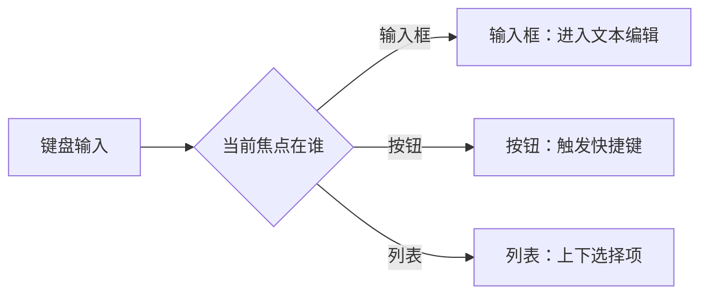
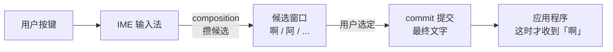

# 输入法、焦点、文本：GUI 的深水区

您要是只写过纯英文的 GUI，脑子里对「输入」多半有个朴素模型：用户按什么键，程序就收到什么字符。可一旦您想在自己的程序里支持中文输入（日文、韩文一个道理），这个模型立刻塌方——用户按了一下 `a`，您收到的根本不是一个字符，是一串看不太懂的事件：composition 开始、composition 更新、候选窗口要画、composition 结束……最后才来一个 commit，告诉您用户真正输入的是「啊」。

> 笔者碎碎念，之前处理一个项目的输入法接入支持的bug，搞到最后发现是输入法引擎接成 Mock 的了（很难想象我当时的表情多么无语）

这就是 GUI 里出了名的深水区。T01 第 8 个器官讲过文本「渲染」那一侧——字符怎么变成字形上屏；这一章讲另一侧，**文本「输入」**：按键怎么变成文字，以及为什么这事比您想的难十倍。

## 焦点：输入归谁，谁就接

先把最基础的一块拎出来——**焦点（focus）**。

屏幕上同时摆着按钮、输入框、列表，您敲一下键盘，系统怎么知道您是想给输入框打字、还是想触发按钮的快捷键？全靠焦点：**任意时刻，（基本上）只有一个控件拥有焦点，键盘输入默认就流向它**。

焦点听着简单，工程上却能绕出花：焦点在哪个窗口、哪个控件？`Tab` 键怎么在控件之间流转？弹个模态对话框，焦点归谁？切到另一个应用再切回来，焦点还在不在原处？这些细节，每个 GUI 框架都有一套规矩，规矩之间还不太一样。但核心就一句：**焦点是稀缺资源，键盘输入只归当前握住它的那一个。**

## keydown ≠ 文字输入：IME 登场

好些人脑子里有个朴素的模型：用户按 `a` 键，程序收到 `a` 字符。这个模型在纯英文里大抵成立，可一搬进中文环境，立刻塌方。

用户按 `a`，他多半不是想要一个英文字母 a，而是想用拼音输入法打一个字——比如「啊」。这时按键不会直接变成字符，它会先进 **IME（输入法编辑器）**：IME 把这次按键攒进一个 **composition**（组合串，比如「a」），弹出一个候选窗口让您挑（啊、阿。。。（干！微软输入法又卡bug，候选框弹不出来了！）），您选定了，IME 才把最终结果 **commit**（提交）成文字，发给应用程序。

看出来没？应用程序**收到的不是按键，是 commit 后的文字**——中间多了 composition、候选、提交这一整套状态机。您要是还按「一个 keydown 一个字符」的朴素模型写代码，中文用户在您的程序里根本打不出字来。

## 自绘控件的痛：IME 得自己接

更扎心的是，这套 IME 机制，系统默认是**挂在系统原生控件上**的。您用 Win32 的 `EDIT`、用浏览器原生的 `<input>`，IME 自动就工作——因为系统认得这些控件是「要接收文本的」，会替您把 IME 接好。

可您一旦自绘画布（ImGui、自己写的编辑器控件、游戏里的输入框），系统就两眼一抹黑了——它不知道您这块画布想接收文本。这时 **IME 接入的活儿就得您自己干**：告诉系统「我要开始接收输入了」、画出 composition 的候选窗口、处理用户的选定、收下 commit 来的文字。麻烦的是，每个平台的 IME API 还都不一样（Windows 的 TSF、macOS 的 Input Method Kit、Linux 的 IBus / Fcitx……）。

这就是为什么 T01 第 12 个器官说「自绘控件最容易在无障碍、IME 上栽」——您省了系统控件的开销，也把系统白送给您的 IME 支持一起给省掉了。

## 这一切为什么叫「深水区」

把这几块摞一块儿瞧，您就明白为什么 GUI 老手一谈起「文本输入」都一脸凝重（我是面如死灰，当时我就负责处理好几个这个bug...）：

- **焦点**跨窗口、跨进程、跨模态对话框，处处有抢占的坑；
- **IME** 每种语言一套逻辑，composition 状态机细抠起来没完没了；
- **自绘控件**的 IME 接入，每个平台一套 API，没一套省心；
- 屋漏偏逢连夜雨，**无障碍**还要求屏幕阅读器能读出 composition 的当前状态——盲人用户也得知道候选窗口里有什么可选。

英文世界的教程，这一块常常一笔带过，甚至干脆不提。可对一个面向中文用户的 GUI 框架来说，它是绕不开的硬骨头。本书在 Act 6（产品化主线）会专门带您啃一遍——现在您只要先记住一件事：**文本输入不是「按键 = 字符」那么简单，它是一整套状态机，IME 在中间做了大量您看不见的活。**

## 一句话收口

下次您看到一个 GUI 框架吹自己「轻量、自绘、跨平台」，先别急着鼓掌——问它一句：**中文输入怎么接？IME 的 composition 状态，它替我管了，还是甩给我自己啃？** 这一问，往往就能试出这个框架到底是「真交付得起」，还是只能跑个 demo。
