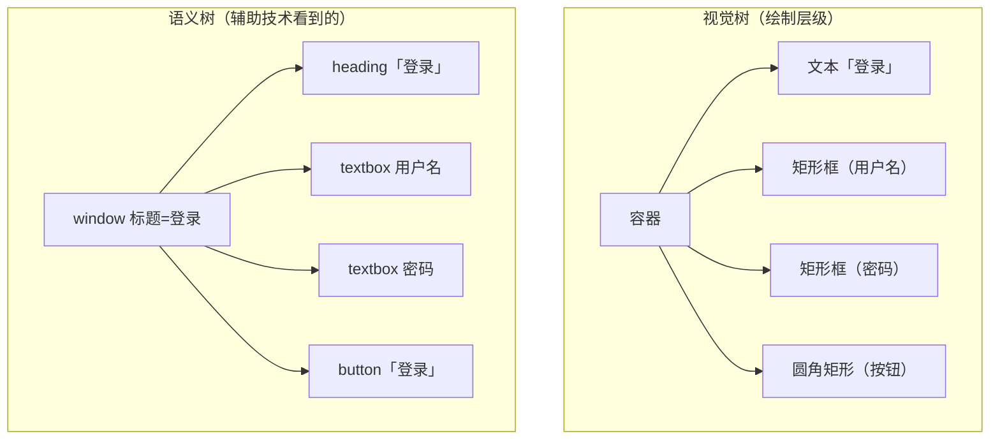
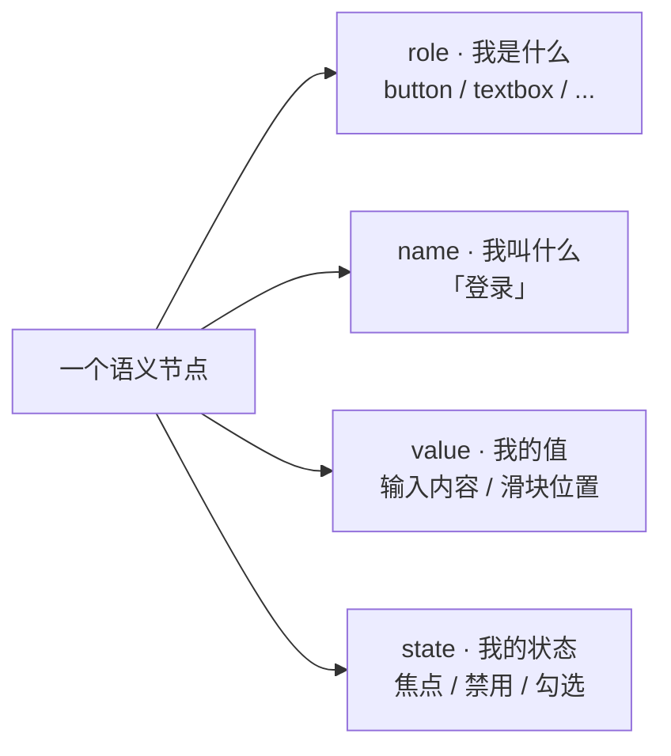

# 可访问性不是附加功能

您不妨做个能吓一跳的小实验：装一个屏幕阅读器（比如免费的 NVDA），拿它跑一遍您自己写的程序。八成会听见，精心摆的按钮、对齐的表单，在它嘴里不是「按钮」「输入框」，是一连串「分组」「分组」「分组」——盲人用户根本没法用。

**屏幕上有像素，不等于这个软件「能用」。** 可访问性（accessibility，常简写为 a11y）——让障碍人士也能用您的软件——不是核心功能做完之后「锦上添花」的附加项，它是一项默认的义务。可惜绝大多数教程，对这事只字不提。

## 屏幕阅读器看到的，不是像素

很多人对屏幕阅读器有个误会：以为它像 OCR 一样，盯着屏幕上的像素，识别出哪里是按钮、哪里是文字。**完全不是。**

屏幕阅读器根本不「看」画面。它读的，是应用程序提供给它的**另一棵树**——叫**语义树**（accessibility tree），跟您画到屏幕上的视觉树是两套东西，平行存在着。

视觉树告诉系统「这里画一个圆角矩形、那里画一串文字」；语义树告诉辅助技术「这里有一个**按钮**、名字叫**登录**、当前**可点**」。屏幕阅读器、放大镜、语音控制、自动化测试工具，全都是从语义树这一侧去读您的程序的。

您那个程序，视觉树上一切正常；可语义树要么没建、要么建得乱七八糟——屏幕阅读器就读出一堆「分组」。

## 语义节点的四要素：role / name / value / state

语义树上每一个节点，得把自己交代清楚四件事：

- **role**：我**是什么**——按钮、输入框、列表、标题？
- **name**：我**叫什么**——「登录」「用户名」「提交」？
- **value**：我的**值**是什么——输入框里的文字、滑块的当前位置？
- **state**：我的**状态**如何——当前有没有焦点？禁用没禁用？勾选没勾选？

这四样齐了，辅助技术才能正确地把您的控件「翻译」给障碍用户。少一样，那一边的体验就缺一块。

## 不止视觉障碍：a11y 的全谱

一提 a11y，好些人只想到「盲人用屏幕阅读器」。其实它的谱宽得多：

- **视觉**：全盲（靠读屏）、低视力（要放大、要高对比度）、色觉障碍（信息不能只靠颜色传达）。
- **运动**：不能用鼠标的键盘用户、有震颤的人（点击目标要够大）、无法精细操作的人。
- **认知**：阅读障碍、注意力问题（界面要清晰、一致、可预测）。

也就是说，**只用键盘能完整操作您的软件、高对比度模式下能看清、字体放大不乱版**——这些统统属于 a11y。它不只是「给盲人加个读屏支持」，是「让各种处境的人都能用」。

## 自绘控件的 a11y 黑洞

最难的是自绘控件。T06 讲过 lightweight 框架（WinUI、Flutter、ImGui、咱们的 MiniUI）——控件背后没有系统原生控件撑着，全靠自己画。**问题来了：您画出来的东西，系统完全不认识**——它只看到一块画布上有些像素，语义树那一边一片空白。

所以 lightweight 框架的 a11y，全靠**开发者手动把语义喂给系统**：每画一个按钮，您得同时往语义树里塞一个「这里是 button、名字叫登录、状态可点」的节点。喂了，读屏软件才读得出；不喂，您画得再漂亮，障碍用户眼里就是虚无。

这就是 lightweight 路线的代价——您从系统控件那儿省下的开销和换来的自由，是用「a11y 要自己重建」换来的。这也是 T01 第 12 个器官那句「自绘控件最容易在可访问性上栽」的真正含义。

## 为什么 a11y 不能「以后再加」

很多人把 a11y 当 icing on the cake（蛋糕上的糖霜）——「先把功能做出来，有空再补 a11y」。这是个昂贵 的误会。

a11y 是**地基**，不是装饰。语义树这东西，如果一开始就没在设计里考虑，等您「做完功能再补」时，往往会发现：控件的语义根本理不清、状态变化没暴露、动态内容没通知读屏——要补，等于把架构重来一遍。这就是为什么成熟的团队有一条铁律：**a11y 从设计的第一张图、代码的第一个控件就开始考虑，不是「上线前补一下」。**

## 一句话收口

下次您写一个控件，别只问「它画出来好不好看、点起来顺不顺」。再问一句：**它在语义树里是什么样子？屏幕阅读器读得到吗？键盘能操作吗？** 这一句问下来，您写出来的，才是「能交付给所有人」的软件，而不是「只在作者自己机器上跑得漂亮」的 demo。

本书在 Act 6 会专门带您给自绘控件补上 a11y；现在，先把「可访问性是默认义务，不是附加功能」这颗种子种下。
