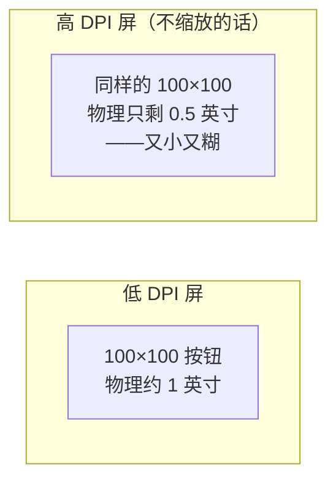
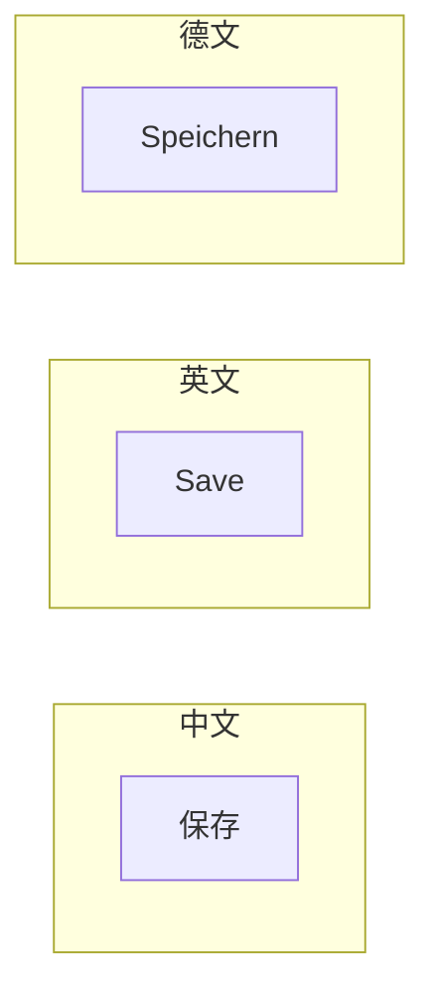
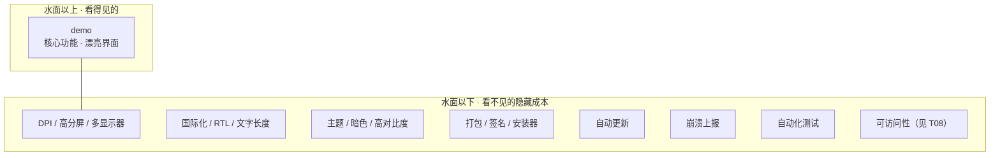

# GUI 的隐藏成本：demo 与真东西的鸿沟

您的 demo，在自己机器上跑得完美。窗口漂漂亮亮，按钮一点就响应，动画丝滑。您心满意足地打包，发给第一个用户——然后，bug 报告像雪花一样飘回来：

「字太小了看不清」「中文菜单换行崩了」「我笔记本是 4K 屏，界面糊成一团」「装不上，系统提示不安全」「闪退，啥也没了」……

您一头雾水：在我这儿明明好好的呀？

这就是 GUI 开发最扎心的一课：**写出一个能跑的 demo，只占整个工程的一小部分。** 把 demo 推向真实软件之间那道鸿沟里，填的全是些「不在功能清单上」的隐藏成本。这一章，就把这些成本一个个点名。

## DPI：一寸像素，不再是一寸

您当年画界面，习惯了「按钮 100×100 像素」。可现在的屏幕，早就不是一种 DPI 了——4K 笔记本、Retina 屏、1080p 台式机、几个 DPI 不一样的显示器拼在一起。

问题来了：同一个 100×100 像素的按钮，在低 DPI 屏上大概是 1 英寸见方，到了高 DPI 屏（如果您不处理），物理尺寸缩成 0.5 英寸——小到点不准、看不清。

解法是引入「逻辑像素」和 DPI 感知：您的界面按逻辑尺寸布局，框架按屏幕 DPI 把它缩放成正确的物理像素。听着简单，可旧代码里满地的硬编码像素值，调起来能把人逼疯。

## 国际化：文字不是定长

您的界面用中文设计，按钮上写「保存」两个字，留了刚好够的宽度。然后您要做英文版——「Save」也还行。再做德文版——「Speichern」，十几个字符，版面直接撑爆了。

国际化（i18n）远不止翻译文字。它还包括：版面要适应文字长度的剧烈变化、阿拉伯语和希伯来语是**从右到左**排（RTL，整个界面要镜像）、日期/数字/货币格式各地不同、有的语言字体根本没有您想要的字重。您要是不一开始就按「文字长度会变」来设计版面，本地化时一定崩。

## 主题与高对比度：您的配色不是世界中心

您精心调了一套配色，深蓝配浅灰，漂亮。可用户的系统开着暗色模式——您的软件亮瞎眼地跳出来；有视觉障碍的用户开了高对比度模式——您的配色全失效，文字和背景糊成一团。

成熟的 GUI 必须尊重系统主题：跟着系统的明暗切换、在高对比度模式下仍可读、尊重用户对强调色的选择。这一切的前提是——**颜色不能硬编码在控件里，要走系统的主题系统**（T01 第 9 个器官那个样式系统，正是干这事的）。

## 打包、签名、更新：让软件真正到用户手里

写完代码不等于交付。您的程序要走到用户机器上，还得过几道关：

- **打包**：把可执行文件、依赖、资源、字体打包成安装器或单文件，每个平台一套规矩。
- **代码签名**：不签名，Windows SmartScreen 直接拦截、macOS Gatekeeper 拒绝运行——用户看到的是「不安全，建议不要运行」，您的软件连第一面都见不着。
- **自动更新**：发出去的软件，您再也没法亲手改。它得能自己检查更新、自己下载、自己替换，而且更新过程中崩了还不能把用户留在坏状态。

## 崩溃与测试：软件活下去的命脉

最后两块，决定您的软件能不能「活下去」：

- **崩溃上报**：在您机器上不崩，不代表在用户机器上不崩——硬件、驱动、系统版本、输入法，变量多到想不完。没有崩溃上报，您根本不知道用户那儿发生了什么，bug 永远修不动。
- **自动化测试**：GUI 测试难写，但不可或缺——总不能每次改一行代码，人肉点一遍所有功能。成熟的 GUI 项目都有一套控件树级别的自动化测试框架。

## 冰山之下

把这些摞一块儿，就是 GUI 工程那座著名的冰山：

水面上的 demo，光鲜、好玩、是您最先写出来的那部分；水面下的隐藏成本，又重、又脏、又没人夸，但缺了任何一块，您的软件都交付不出去。**GUI 新手和老手的一半差距，不在水面上，在水下面。**

本书在 Act 6 会带您把水面下的每一块逐个啃掉。现在，您只要先记住：**写完功能，工程才刚刚开始。**

---

## 理论篇到此收尾

Act0 这十章理论，到这儿就讲完了。回头一看，您手里已经攥着一张完整的 GUI 世界观：

- 一张 **12 个器官**的地图（T01）；
- 两道根本分叉——**保留 vs 即时**（T02）、**命令 vs 声明 vs 响应**（T03）；
- 一族 **架构模式的四代演进**（T04）；
- 一颗 **事件循环**的心脏，和它带来的卡死、模态、重入、协程（T05）；
- 控件作为**对象**的四种活法（T06）；
- 文本**输入**那道 IME 深水区（T07）；
- **可访问性**这条默认义务（T08）；
- 以及 demo 脚下的那座**隐藏成本冰山**（T09）。

往后您看任何一个 GUI 框架，都可以拿这套世界观往它身上套——陌生感会褪掉大半。

可光有理论，终究是纸上谈兵。T00 开篇那张阅读路径图上，下一站是**标本**——拿一具最透明、最赤裸的 GUI 框架开刀解剖。Win32，就是那具标本。

咱们，下一幕见。
